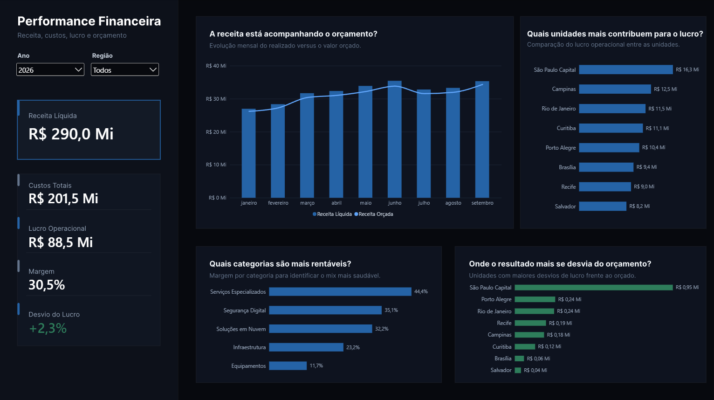
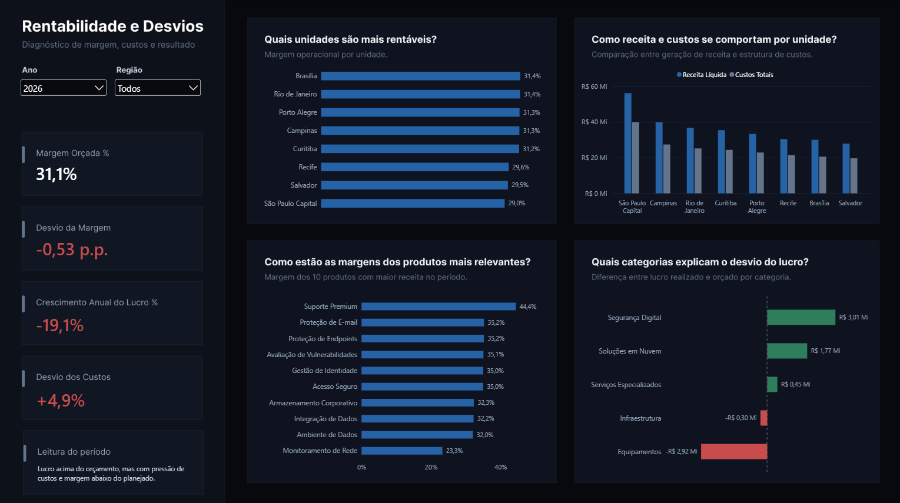
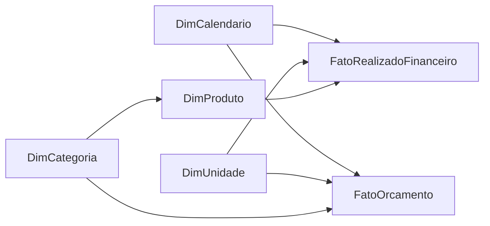

# Performance Financeira e Rentabilidade | Power BI

Dashboard de Power BI voltado à análise de **performance financeira, rentabilidade e desvios entre realizado e orçamento**.

O projeto foi construído como exercício de portfólio para representar um cenário de análise gerencial. A base é **100% sintética** e foi desenhada para permitir análise por período, região, unidade, categoria e produto, respeitando a granularidade real de cada fato.

## Dashboard interativo

**Power BI Service:**  
https://app.powerbi.com/view?r=eyJrIjoiOWE2ZDhkZTYtMTgxZC00MDRlLWE0YmUtYzBjY2IxYWViYWI3IiwidCI6IjBmYjA0MGNiLWVhODgtNDFjYS1iYjVmLTVhZGRkNDBmZjZjYyJ9

> O relatório foi publicado com dados sintéticos e não contém informações corporativas ou pessoais reais.

## Visão geral

O dashboard foi organizado em duas páginas com funções diferentes:

1. **Performance Financeira** — visão executiva do resultado, orçamento, margem e contribuição das unidades.
2. **Rentabilidade e Desvios** — diagnóstico das diferenças de margem, custos, crescimento do lucro e fatores que explicam o resultado.

### Página 1 — Performance Financeira



A primeira página responde principalmente:

- Qual foi a receita, o custo, o lucro e a margem no período?
- A receita realizada acompanha o orçamento?
- Quais unidades mais contribuem para o lucro?
- Quais categorias apresentam maior margem?
- Onde o lucro mais se desvia do orçamento?

### Página 2 — Rentabilidade e Desvios



A segunda página aprofunda o diagnóstico:

- Quais unidades são mais eficientes em margem?
- Como receita e custos se comportam por unidade?
- Como estão as margens dos produtos de maior receita?
- Quais categorias explicam os desvios de lucro?
- A qualidade do resultado está melhorando ou sendo pressionada por custos e margem?

## Principais insights

No recorte de 2026 exibido no relatório:

- O lucro operacional ficou **2,3% acima do orçamento**, mas a margem realizada ficou cerca de **0,53 p.p. abaixo da margem orçada**.
- Os custos ficaram **4,9% acima do orçamento** e o lucro apresentou **queda anual de 19,1%**, mostrando que superar a meta de lucro não significa necessariamente melhora da qualidade do resultado.
- **Segurança Digital (+R$ 3,01 mi)** e **Soluções em Nuvem (+R$ 1,77 mi)** compensam principalmente o desempenho negativo de **Equipamentos (-R$ 2,92 mi)**.
- **Equipamentos** também apresenta a menor margem entre as categorias, em torno de **11,7%**, enquanto **Serviços Especializados** chega a aproximadamente **44,4%**.
- **São Paulo Capital** lidera em escala e lucro absoluto, mas apresenta uma das menores margens entre as unidades, reforçando que **escala e eficiência não são a mesma coisa**.

## Modelo de dados

O modelo segue uma estrutura dimensional com dimensões compartilhadas entre fatos.



### Relacionamentos principais

- `DimCalendario[DataChave]` → fatos
- `DimUnidade[UnidadeID]` → fatos
- `DimCategoria[CategoriaID]` → `DimProduto[CategoriaID]`
- `DimCategoria[CategoriaID]` → `FatoOrcamento[CategoriaID]`
- `DimProduto[ProdutoID]` → `FatoRealizadoFinanceiro[ProdutoID]`

Uma decisão importante foi **não relacionar diretamente `DimCategoria` à fato realizada**, evitando ambiguidade. No realizado, o filtro de categoria chega ao fato por `DimCategoria → DimProduto → FatoRealizadoFinanceiro`.

## Granularidade

Os dois fatos possuem granularidades diferentes:

| Tabela | Granularidade |
|---|---|
| `FatoRealizadoFinanceiro` | mês × unidade × produto |
| `FatoOrcamento` | mês × unidade × categoria |

O orçamento não existe no nível de produto. Por isso, o projeto **não distribui artificialmente o orçamento entre produtos**. Comparações de realizado x orçamento são feitas apenas nos níveis suportados pelos dados.

## Indicadores analisados

- Receita Líquida
- Custos Totais
- Lucro Operacional
- Margem %
- Receita, custos e lucro orçados
- Desvio de Receita
- Desvio de Custos
- Desvio de Lucro
- Desvio de Margem em pontos percentuais
- Crescimento anual do lucro
- Margem por unidade, categoria e produto
- Ranking dos produtos por receita

As principais medidas estão documentadas em [`docs/medidas-dax.md`](docs/medidas-dax.md).

## Storytelling e design

A construção visual segue uma lógica de **visão executiva → diagnóstico**:

```text
Resultado consolidado
        ↓
Realizado x orçamento
        ↓
Contribuição e rentabilidade
        ↓
Desvios
        ↓
Diagnóstico por unidade, categoria e produto
```

Algumas decisões de design:

- duas páginas para evitar excesso de informação;
- perguntas de negócio como títulos dos visuais;
- verde e vermelho reservados para variações favoráveis/desfavoráveis;
- fundo escuro e paleta reduzida;
- uso de barras e colunas para facilitar comparação;
- destaque de uma leitura dinâmica do período na página de diagnóstico;
- remoção de visuais que aumentavam a carga cognitiva sem melhorar a interpretação.

## Estrutura da base

Período disponível: **jan/2024 a set/2026**.

- 8 unidades
- 4 regiões
- 5 categorias
- 30 produtos
- 7.920 registros de realizado
- 1.320 registros de orçamento

Os dados utilizados são sintéticos e reproduzíveis. A base está disponível em [`data/`](data/).

## Estrutura do repositório

```text
performance-financeira-rentabilidade/
├── assets/
│   ├── pagina-1-performance-financeira.png
│   └── pagina-2-rentabilidade-desvios.png
├── data/
│   ├── Base_Performance_Financeira_Rentabilidade_PTBR.zip
│   └── README.md
├── docs/
│   └── medidas-dax.md
├── powerbi/
│   └── Performance_Financeira_Rentabilidade.pbix
├── .gitignore
└── README.md
```

## Como explorar o projeto

A maneira mais simples é acessar o **dashboard interativo no Power BI Service** pelo link no início deste README.

Para abrir localmente:

1. baixe o arquivo `.pbix` em `powerbi/`;
2. abra-o no Power BI Desktop;
3. utilize os filtros de Ano e Região para explorar as duas páginas.

## Tecnologias

- Power BI Desktop
- Power Query
- DAX
- Modelagem dimensional
- Power BI Service

## Observação

Este projeto foi desenvolvido exclusivamente para portfólio. Os dados, empresas, unidades, produtos e resultados utilizados são fictícios e não representam informações reais de nenhuma organização.
